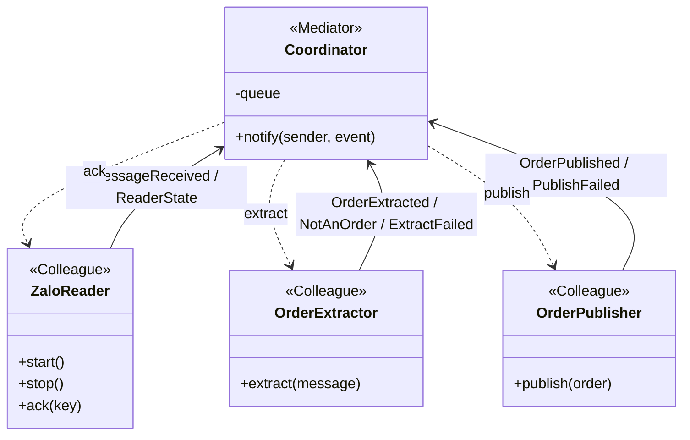
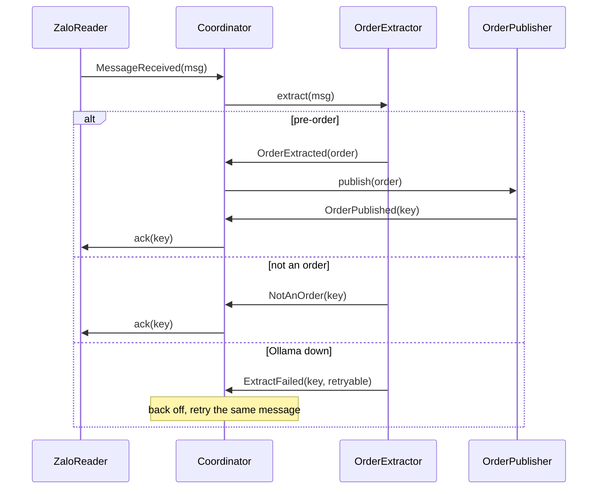

# Zalo Order Assistant

## Status
Draft. Requirements: defined (pre-order only). Everything else: placeholder.

Spikes this builds on:
- [zalo-adater](../zalo-adater/spec.md): reads Zalo Web, de-duplicates by message key, publishes to Supabase.
- [extract-order-agent](../extract-order-agent/specs.md): Qwen (Ollama) turns one message into an order.
- [bep-phuong-bac-supabase](/Users/vung.do/projects/startup/bep-phuong-bac-supabase/spec.md): **backend and front-end already built and working.** Staff list orders per day and tick them delivered; `POST /functions/v1/orders` is an idempotent upsert on `(source, external_id)`.

So this project adds no backend or UI. It only connects Zalo messages to that existing API.

# 1. Requirements

## 1.1 Problem
Customers pre-order food by posting free-text messages in a Zalo group. The shop has to read the chat to know who ordered and how many. The system turns each pre-order message into a simple record.

## 1.2 Scope
**In scope (v1):** detect a pre-order message and store four things:

| Field | Meaning |
|---|---|
| `who` | Customer name (the Zalo sender, for example "Hiền Max", "Mai") |
| `qty` | Number of portions |
| `date` | The day the food is wanted (`YYYY-MM-DD`), worked out from day words such as "mai" or "ngày kia" (see §1.4). Stored as `delivery_date`, which Supabase requires (not null). When the message names no day, it defaults to the message created date. |
| `message` | The original message text. Anything else, such as "ship" or an address, stays here and is not parsed. |

**Out of scope (v1):** the backend and UI (already built in Supabase, including the delivered tick), shipping/pickup field, address, per-dish menu, totals/reports, kitchen voice/display, payment, replying in Zalo, multiple groups, images/stickers/voice.

## 1.3 Functional Requirements

| ID | Pri | Requirement |
|---|---|---|
| FR-1 | M | The system shall read new text messages from the configured Zalo group chat. *(done in the spike)* |
| FR-2 | M | The system shall decide whether a message is a pre-order. Non-orders shall be ignored. *(spike: agent returns `NotAnOrder`)* |
| FR-3 | M | For a pre-order, the system shall store `who`, `qty`, `date` and `message`. |
| FR-4 | M | `who` shall be the Zalo sender name. |
| FR-5 | M | `qty` shall be a whole number ≥ 1. When no quantity is stated, it shall default to `1`. |
| FR-6 | M | `message` shall be the original text, unchanged (cut at 2000 characters). |
| FR-6a | M | `date` shall be resolved from the day words in §1.4, relative to the **message created date** (`sentAt`, timezone Asia/Ho_Chi_Minh), not the date the message is processed. The created date and its weekday shall be passed to the model in the prompt on every call. The model shall never invent a day: with no day word it returns none, and the system then applies the default (FR-6b). |
| FR-6b | M | When the message names no day, `date` shall default to the message created date (this is what the agent does today). |
| FR-7 | M | Each message shall produce at most one order. The Zalo message key is the idempotency key, so reading or retrying the same message never creates a duplicate. *(done in the spike)* |
| FR-8 | S | Edited messages are not supported: Zalo does not allow editing a sent message, so each message is read once and never changes. |
| FR-9 | M | Orders shall be saved through the existing Supabase `orders` API: `source=zalo`, `external_id` = Zalo message key, `customer_name`=`who`, `quantity`=`qty`, `delivery_date`=`date`, `message`. *(done in the spike)* An update shall never reset `delivered` (Supabase S18). |
| FR-10 | S | The system shall retry when the agent or Supabase is down, without losing or duplicating messages. *(done in the spike)* |

## 1.4 Day Words (defined in the prompt)

The prompt states the **message created date** and its weekday (call it "today" below), then the table below, computed fresh for each message. A message read late, restarted or backfilled still resolves against the day it was written. Vietnamese is matched with and without diacritics ("mai" = "mai", "ngày mai" = "ngay mai").

| Word | Meaning | Offset | Example (created Mon 2026-11-23) |
|---|---|---|---|
| hôm nay, nay | today | 0 | 2026-11-23 |
| mai, ngày mai | tomorrow | +1 | 2026-11-24 |
| ngày kia, kia, ngày mốt, mốt | day after tomorrow | +2 | 2026-11-25 |
| thứ hai … thứ bảy, chủ nhật (also "t2" … "t7", "cn") | the **next** such day, strictly after today. Today's own weekday means the same day next week. | 1–7 | "thứ sáu" = 2026-11-27, "thứ hai" = 2026-11-30 |
| ngày 28, 28/11 | that calendar date. If it has already passed this month/year, the next occurrence. | - | 2026-11-28 |

Rules:
- **Past day words are not pre-orders.** A message that refers to a past day ("hôm qua", "hôm kia", "tuần trước") is ignored as not an order. These words are not in the table on purpose, and no past `date` is ever stored.
- A weekday is never resolved to a day on or before the created date.
- A message with more than one day word is not a single order: reject it (like several orders in one message).
- The time of day ("trưa mai", "tối nay") does not change the date.
- The system clock is not used to resolve `date`. If the created date is unknown, the message is not processed (retry), and the system date is never used as a fallback.

## 1.5 Non-Functional Requirements
| ID | Requirement |
|---|---|
| NFR-1 | Chat content stays local: extraction uses a local Qwen model, and data goes only to the owner's Supabase. |
| NFR-2 | A restart shall not lose or duplicate orders. |
| NFR-3 | Secrets and message text shall never be logged. |
| NFR-4 | Vietnamese text with diacritics, abbreviations and emoji shall be handled. |

## 1.6 Acceptance Criteria

| ID | Given / When | Then |
|---|---|---|
| AC-1 | Mai posts "Mai đặt 2 phần, ship nhé" | One order: `who=Mai`, `qty=2`, `message` = the original text. |
| AC-2 | Mai posts "đặt cơm" | `qty=1`. |
| AC-3 | Someone posts "ok nhé" or a sticker | No order. |
| AC-4 | The same message is read twice (restart or backfill) | Still one order. |
| AC-5 | Mai posts "hôm qua mình đặt 2 phần" | Not an order. Nothing saved. |
| AC-6 | Mai posts a second, separate order message | A second order is created (different message key). |
| AC-7 | Supabase is down when an order is extracted | The message is held and retried, then saved once, with no duplicate. |
| AC-8 | Mai's message created Mon 2026-11-23: "mai lấy 2 phần" | `date=2026-11-24`. |
| AC-9 | Created Mon 2026-11-23: "ngày kia 3 phần" (or "mốt 3 phần") | `date=2026-11-25`. |
| AC-10 | Created Mon 2026-11-23: "thứ sáu 1 phần" | `date=2026-11-27`. |
| AC-11 | Created Mon 2026-11-23: "thứ hai 1 phần" | `date=2026-11-30` (next Monday, not the created day). |
| AC-12 | Created Mon 2026-11-23: "hôm nay 1 phần" | `date=2026-11-23`. |
| AC-13 | Created Mon 2026-11-23: "2 phần" with no day word | Order saved with `date=2026-11-23` (the created date). |
| AC-14 | "mai 2 phần, kia 1 phần" | Rejected as more than one order. Nothing saved. |
| AC-15 | The message "mai 2 phần" was created on 2026-11-20 but is processed on 2026-11-23 (backfill or restart) | `date=2026-11-21`, from the created date, not the processing date. |

## 1.7 Assumptions
- One configured group chat, read through Zalo Web with browser automation (as in the spike).
- The Zalo message key is stable across reloads *(the spike relies on this)*.
- Messages are mostly Vietnamese.
- Single operator, single running instance.

## 1.8 Open Questions
1. ~~Backfill~~: resolved. The reference day is the message created date.
2. ~~No day word~~: resolved. Supabase requires `delivery_date`, so it defaults to the message created date.
3. ~~"kìa"~~: resolved. Only "mai" (+1) and "kia" (+2) are defined.
4. ~~Past day words~~: resolved. Not pre-orders, ignored.
5. ~~Edits~~: resolved. Zalo has no edit, so edit handling is skipped.

No open questions remain.

**Gaps against the current agent prompt** ([llm.py](../extract-order-agent/src/extract_agent/llm.py)): it injects the **system date** (`today`), and its validator also compares dates to the system date, so it must switch to the message `sentAt` date (the adapter already sends `sentAt` in the request). It maps hôm qua (to be removed: past words must mean "not an order", and the validator's "past date" rejection should become `NotAnOrder`), hôm nay, mai and ngày kia. Missing: "kia"/"mốt" alone, abbreviations (t2…t7, cn), calendar dates, the explicit "next weekday, never today" rule, and the multi-day rejection.

---

# 2. Design

## 2.1 Approach
Mediator pattern. One **Coordinator** (the mediator) knows every component. The three components (colleagues) know only the Coordinator: they report what happened as **events**, and they do what the Coordinator tells them as **commands**. No component calls another one directly, so each can be replaced or tested alone (for example, a fake Reader that replays messages, or a different LLM).

This replaces the spike's pull loop (the Orchestrator polling the adapter) with an event-driven flow: the Reader pushes a new message, and the Coordinator drives the rest. The spike's code is reused inside the colleagues (see §2.9).



## 2.2 Modularity

Each colleague is a **separate module** with a narrow public interface, so it can be built, tested and replaced on its own.

- Each lives in its own package with its own tests, and exposes one `Protocol` (interface) plus a factory. The Coordinator imports only the three Protocols and the shared `events` module, never a concrete class.
- A colleague imports nothing from another colleague. They share only `events.py` (plain data types).
- Each owns its dependencies and config: only the Reader knows about the browser and Zalo selectors, only the Extractor about Ollama and the prompt, and only the Publisher about Supabase.
- `main.py` is the only place that picks the concrete implementations and wires them to the Coordinator.
- Because of this, the Extractor can later move behind HTTP, or the Reader be swapped for a fake that replays messages, with no change to the Coordinator or the other colleagues.

```python
class MessageSource(Protocol):       # ZaloReader
    def start(self) -> None: ...
    def stop(self) -> None: ...
    def ack(self, key: str) -> None: ...

class Extractor(Protocol):           # OrderExtractor
    def extract(self, message: Message) -> None: ...   # result arrives as an event

class Publisher(Protocol):           # OrderPublisher
    def publish(self, order: Order) -> None: ...        # result arrives as an event
```

Each colleague is built with the Coordinator (`ZaloReader(mediator, config)`), and reports through `mediator.notify(...)`.

## 2.3 Components (colleagues)

### ZaloReader
Opens Zalo Web (headed browser, persistent profile, so the QR login is needed once), attaches to the configured chat, and notifies the Coordinator of each new text message.

- **Chat target (config `ZALO_CHAT`)**: the title of the **group chat** to read (v1 reads groups only). The Reader **searches for the title in Zalo Web's search box and opens the matching chat itself**, so the operator does not open it by hand. A private chat with the same title is never opened.
  - Opens the chat after login, and again if the user navigates elsewhere or the page reloads.
  - Matches the title exactly (after trimming spaces, ignoring case and diacritics). With several matches it picks the exact one; with none, or with only partial matches, it emits `ChatNotFound` and keeps retrying, and it never opens a different chat.
  - If `ZALO_CHAT` is empty, it reads the chat that is already open, and it requires that chat to be a group.
- **Reads**: new text messages, oldest first. On start, or when the chat changes, it also reads the last `BACKFILL_DAYS` days of history. Images, stickers and files are skipped.
- **De-duplicates** by message key in a local store, so a restart never re-emits a handled message. A key is stored only after `ack(key)`.
- **Emits** `MessageReceived(message)` and `ReaderState(state)`, where state is `READY`, `LOGIN_REQUIRED`, `CHAT_NOT_FOUND`, `NO_CHAT_OPEN`, `SELECTOR_DRIFT`, `BROWSER_FAILED`.
- **Takes** `ack(key)` (mark the message done) and `start()` / `stop()`.

### OrderExtractor
Runs **in-process** inside the same Python process as the Coordinator, with no HTTP service, no token and no separate deployment. It calls the local Qwen model (Ollama) to decide if a message is a pre-order and extract `who`, `qty`, `date`. Applies the day-word rules (§1.4) against the message created date, and validates the model output before returning it.

- **Takes** `extract(message)`.
- **Emits** one of `OrderExtracted(order)`, `NotAnOrder(key, reason)` (chat, past day, several orders, bad quantity), or `ExtractFailed(key, retryable)` (Ollama down or timeout is retryable; invalid output is not).
- Stateless. The message key is passed through so an event always names its message.

### OrderPublisher
Creates or updates the order through the Supabase `orders` Edge Function (`source=zalo`, `external_id` = message key). The upsert makes retries safe.

- **Takes** `publish(order)`.
- **Emits** `OrderPublished(key)` (201 or 200) or `PublishFailed(key, retryable)` (network, 408, 429, 5xx and 401 are retryable; 400, 405, 422 are not).

## 2.4 Messages and events

```text
Message        key, chat, sender, text, sent_at (tz-aware, Asia/Ho_Chi_Minh)
Order          key, who, qty, date (YYYY-MM-DD), message

Reader   → Coordinator   MessageReceived(Message) · ReaderState(state)
Extractor→ Coordinator   OrderExtracted(Order) · NotAnOrder(key, reason) · ExtractFailed(key, retryable)
Publisher→ Coordinator   OrderPublished(key) · PublishFailed(key, retryable)
Coordinator → Reader     ack(key)
Coordinator → Extractor  extract(Message)
Coordinator → Publisher  publish(Order)
```

## 2.5 Coordinator rules (the mediation logic)

All cross-component logic lives only here.

| When the Coordinator receives | It does |
|---|---|
| `MessageReceived` | Adds the message to the queue, if its key is not already queued or in flight. |
| (worker takes the next message) | Sends `extract(message)`. |
| `OrderExtracted` | Sends `publish(order)`. |
| `NotAnOrder` | Sends `ack(key)`. The message is done, with nothing saved. |
| `OrderPublished` | Sends `ack(key)`. The message is done. |
| `ExtractFailed` / `PublishFailed`, retryable | Keeps the message at the head of the queue and retries it after a backoff (2 s, doubling, up to 60 s). |
| `ExtractFailed` / `PublishFailed`, not retryable | Logs the status and key, never the text, then sends `ack(key)` so one bad message cannot block the queue. |
| `ReaderState` other than `READY` | Logs it, shows it to the operator, and keeps waiting. It never exits. `BROWSER_FAILED` after repeated restarts stops the Coordinator. |

Guarantees:
- **Order**: one worker handles one message at a time, oldest first, so a retry holds back newer messages and the order is kept.
- **At-least-once, no duplicates**: a message is acked only after its order is stored, or after it is known to produce none. A re-sent message upserts the same Supabase row through `external_id`.
- **Restart**: the Reader's store holds only acked keys, so un-acked messages are re-emitted and re-processed safely.

## 2.6 Flow



## 2.7 Configuration

| Variable | Default | Meaning |
|---|---|---|
| `ZALO_CHAT` | empty | Title of the group chat to search for and open (groups only). Empty = the chat currently open. |
| `BACKFILL_DAYS` | `3` | History read when a chat is opened. |
| `POLL_INTERVAL_SECONDS` | `2` | Reader polling interval. |
| `OLLAMA_URL`, `OLLAMA_MODEL` | `http://localhost:11434`, `qwen2.5:7b-instruct` | Local LLM. |
| `LLM_TIMEOUT_SECONDS` | `20` | Per extraction call. |
| `SUPABASE_URL`, `SUPABASE_API_KEY` | required | Orders API. The key is never logged. |
| `RETRY_MAX_BACKOFF_SECONDS` | `60` | Retry ceiling. |

## 2.8 Project structure

```text
zalo-order-assistant/
├── pyproject.toml
├── src/zalo_order_assistant/
│   ├── events.py             # Message, Order, all event types (shared, data only)
│   ├── coordinator.py        # mediator: queue, rules in §2.5; imports only the Protocols
│   ├── ports.py              # MessageSource, Extractor, Publisher Protocols
│   ├── main.py               # the only place that wires concrete colleagues
│   ├── zalo_reader/          # browser, selectors, chat search/open, de-dup store
│   ├── order_extractor/      # Qwen prompt, day words, validation (in-process)
│   └── order_publisher/      # Supabase client
└── tests/                    # one folder per module, plus coordinator tests with fakes
```

Each colleague receives the Coordinator through its constructor and has no import of another colleague.

## 2.9 Reuse from the spikes

| New | Reuses |
|---|---|
| ZaloReader | zalo-adater: `browser.py`, `reader.js`, `zalo_web.py`, `messages_repo.py`. The poll loop becomes a push. **New work:** search for the chat title and open it. |
| OrderExtractor | extract-order-agent: `llm.py`, `validate.py`, copied into the module and run in-process (no HTTP call, no token). Needs the changes noted in §1.8. The agent's SQLite per-day numbering is not used, because Supabase already stores the orders. |
| OrderPublisher | zalo-adater: the Supabase publisher. |
| Coordinator | zalo-adater: the Orchestrator's queue, retry and ack rules, now driven by events. |

## 2.10 Open design questions
1. ~~Extractor deployment~~: resolved. In-process, as its own module.
2. ~~Selecting the chat~~: resolved. The Reader searches by title and opens the chat. This is **new work**: the spike never searched, so the search box selectors and the exact-match rule must be verified against the live Zalo Web (it may also drift when Zalo changes its page).
3. ~~Same title for a group and a person~~: resolved. v1 reads group chats only, so only a group result is accepted.
