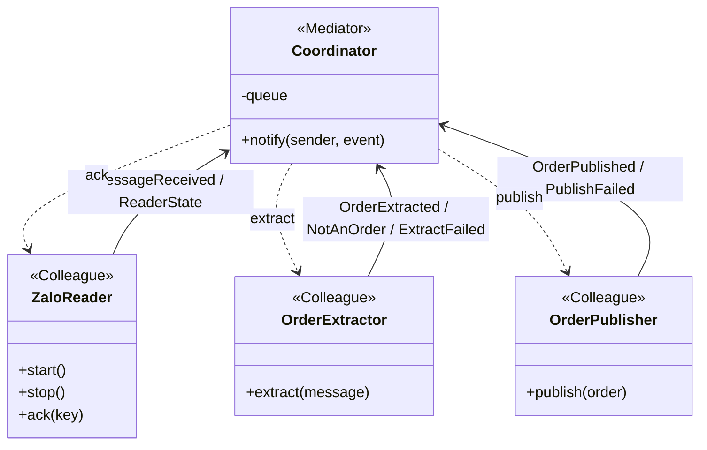
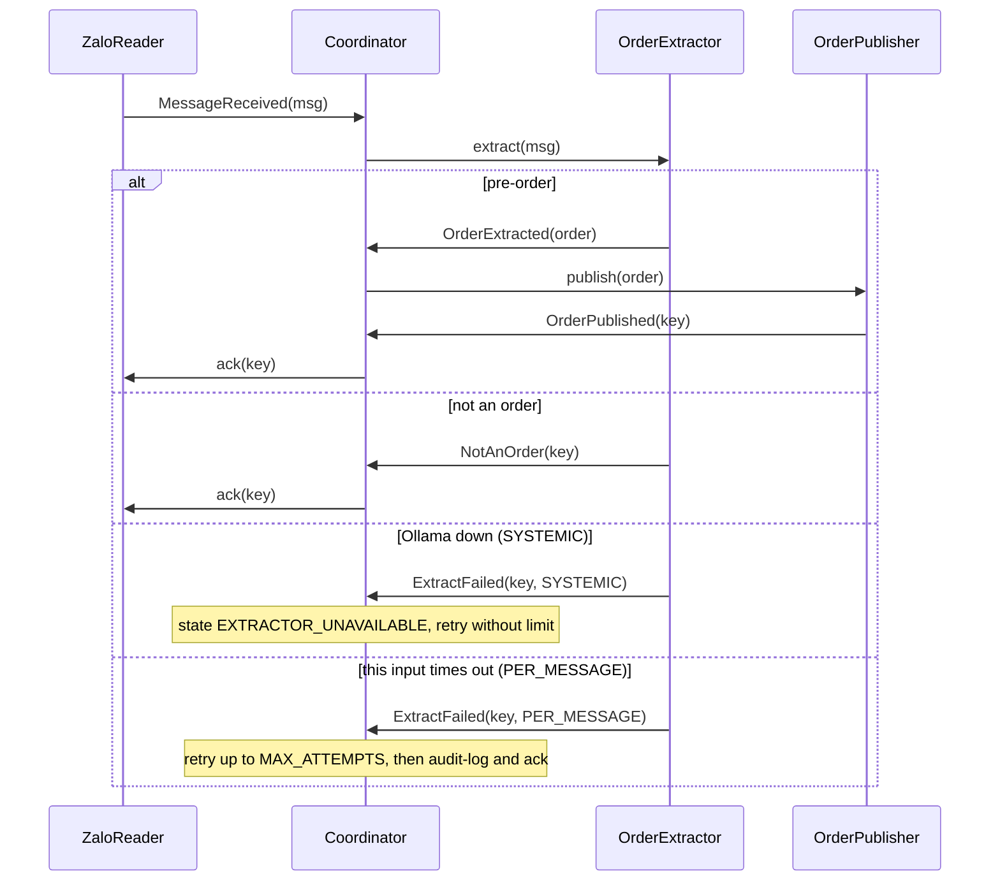

# Zalo Order Assistant

## Status
> **Amended by [spec v2](spec.v2.md) (order adjustments, 2026-11-26).** Messages can now reduce, set or cancel an order, and each message is one immutable line on the customer's order for the day. FR-2 (cancellations) and AC-6 (a second message) below are changed there.

**Approved.** Spec phase closed on 2026-11-23. Requirements (§1), design (§2) and implementation tasks (§3) are defined and were reviewed against the spike code. Next phase: implementation, starting with T0 to T3 (§3.2). Scenarios and test plan details are placeholders, to be written as part of T7.

Spikes this builds on:
- [zalo-adater](../zalo-adater/spec.md): reads Zalo Web, de-duplicates by message key, publishes to Supabase.
- [extract-order-agent](../extract-order-agent/specs.md): Qwen (Ollama) turns one message into an order.
- [bep-phuong-bac-supabase](/Users/vung.do/projects/startup/bep-phuong-bac-supabase/spec.md): **backend and front-end already built and working.** Staff list orders per day and tick them delivered; `POST /functions/v1/orders` is an idempotent upsert on `(source, external_id)`.

So this project adds no backend or UI. It only connects Zalo messages to that existing API.

# 1. Requirements

## 1.1 Problem
Customers pre-order food by posting free-text messages in a Zalo group. The shop has to read the chat to know who ordered and how many. The system turns each pre-order message into a simple record.

## 1.2 Scope
**In scope (v1):** detect a pre-order message and store four things:

| Field | Meaning |
|---|---|
| `who` | Customer name (the Zalo sender, for example "Hiền Max", "Mai") |
| `qty` | Number of portions |
| `date` | The day the food is wanted (`YYYY-MM-DD`), worked out from day words such as "mai" or "ngày kia" (see §1.4). Stored as `delivery_date`, which Supabase requires (not null). When the message names no day, it defaults to the message created date. |
| `message` | The original message text. Anything else, such as "ship" or an address, stays here and is not parsed. |

**Out of scope (v1):** the backend and UI (already built in Supabase, including the delivered tick), shipping/pickup field, address, per-dish menu, totals/reports, kitchen voice/display, payment, replying in Zalo, multiple groups, images/stickers/voice.

## 1.3 Functional Requirements

| ID | Pri | Requirement |
|---|---|---|
| FR-1 | M | The system shall read new text messages from the configured Zalo group chat. *(done in the spike)* |
| FR-2 | M | *(Amended by spec v2: cancellations and changes to an order are now orders, with an `op`.)* The system shall decide whether a message is a pre-order, meaning a request for food to be prepared. Non-orders shall be ignored. Confirmations, receipts, thanks, questions and reports about an existing order ("đã nhận 2 phần", "nhận rồi", "2 phần ngon quá") are **not** orders, even when they contain a number of portions. *(spike: agent returns `NotAnOrder`)* |
| FR-3 | M | For a pre-order, the system shall store `who`, `qty`, `date` and `message`. |
| FR-4 | M | `who` shall be the Zalo sender's display name as shown on the message. Messages from the operator's own account (`is_self`) shall be skipped by default (config `INCLUDE_OWN_MESSAGES=false`), so an owner typing on a customer's behalf is not saved as the owner's order. A message with no readable sender name (only a numeric uid) shall not be saved and shall be recorded as skipped (FR-8). |
| FR-5 | M | `qty` shall be a whole number ≥ 1. When no quantity is stated, it shall default to `1`. |
| FR-6 | M | `message` shall be the original text, unchanged (cut at 2000 characters). |
| FR-6a | M | `date` shall be resolved from the day words in §1.4, relative to the **message created date** (`sentAt`, timezone Asia/Ho_Chi_Minh), not the date the message is processed. The created date and its weekday shall be passed to the model in the prompt on every call. The model shall never invent a day: with no day word it returns none, and the system then applies the default (FR-6b). When the created date is unknown, the Reader shall not emit the message at all (§2.3), so a zero or missing time can never become a 1970 date. |
| FR-6b | M | When the message names no day, `date` shall default to the message created date (this is what the agent does today). |
| FR-7 | M | Each message shall produce at most one order. The Zalo message key is the idempotency key, so reading or retrying the same message never creates a duplicate. *(done in the spike)* |
| FR-8 | M | Every message that is read but produces no order (not an order, rejected, permanent failure, skipped sender, retry cap reached) shall be recorded in a local audit log with `key`, `sent_at`, `reason` and `status`. **The message text is never stored there** (NFR-3). The operator can check a missing order against Zalo by hand. |
| FR-9 | M | Orders shall be saved through the existing Supabase `orders` API: `source=zalo`, `external_id` = Zalo message key, `customer_name`=`who`, `customer_id` = `zalo:<sender's Zalo user id>` when known (not for own messages), so a customer who changes their display name keeps one identity, `quantity`=`qty`, `delivery_date`=`date`, `message`, `placed_at` = message created time (`sentAt`, RFC 3339 with `+07:00`) so the web app shows when the customer ordered, not when the order was published. *(done in the spike)* An update shall never reset `delivered` (Supabase S18). |
| FR-10 | M | The system shall retry when the agent or Supabase is down, without losing or duplicating messages. Failures are of three kinds (§2.5): **systemic** (nothing can work until it is fixed: Ollama down, Supabase unreachable or 401), retried without limit and shown to the operator as a pipeline state; **per-message** (this one input keeps failing: for example an Ollama timeout), retried up to `MAX_ATTEMPTS`; **permanent** (400/405/422, unusable model output), never retried. |
| FR-11 | M | When a message reaches `MAX_ATTEMPTS` (default 5) per-message failures, the system shall acknowledge it as failed and record it (FR-8), so one bad message cannot block the queue for good. |

## 1.4 Day Words (defined in the prompt)

The prompt states the **message created date** and its weekday (call it "today" below), then the table below, computed fresh for each message. A message read late, restarted or backfilled still resolves against the day it was written. Vietnamese is matched with and without diacritics ("mai" = "mai", "ngày mai" = "ngay mai").

| Word | Meaning | Offset | Example (created Mon 2026-11-23) |
|---|---|---|---|
| hôm nay, nay | today | 0 | 2026-11-23 |
| mai, ngày mai | tomorrow | +1 | 2026-11-24 |
| ngày kia, ngày mốt, mốt | day after tomorrow | +2 | 2026-11-25 |
| kia, **only** directly before a quantity or an order word ("kia 2 phần", "kia đặt 3 phần") | day after tomorrow | +2 | 2026-11-25 |
| thứ hai … thứ bảy, chủ nhật (also "t2" … "t7", "cn") | the **next** such day, strictly after today. Today's own weekday means the same day next week. | 1–7 | "thứ sáu" = 2026-11-27, "thứ hai" = 2026-11-30 |
| ngày D (day of month only, "ngày 28") | this month if D is on or after the created day, otherwise next month. "ngày 23" sent on the 23rd means today. | - | "ngày 28" = 2026-11-28, "ngày 23" = 2026-11-23, "ngày 5" = 2026-12-05 |
| D/M ("28/11"), D/M/YYYY ("28/11/2026") | that date, **day first, then month** (never M/D). Without a year: this year if on or after the created date, otherwise next year. | - | "28/11" = 2026-11-28 |

Rules:
- **Past day words are not pre-orders.** A message that refers to a past day ("hôm qua", "hôm kia", "tuần trước") is ignored as not an order. These words are not in the table on purpose, and no past `date` is ever stored.
- A weekday is never resolved to a day on or before the created date.
- A message that resolves to **more than one different date** is not a single order: reject it (like several orders in one message). Repeating the same day is fine: "mai nhé, trưa mai 2 phần" is one order for the same date.
- **Horizon**: a resolved date more than `MAX_DAYS_AHEAD` (default 31) days after the created date is not a pre-order (it is most likely a past date, for example "28/11" written in December). The message is ignored as not an order.
- **Invalid dates** ("31/11", "30/2") are not orders.
- **"kia" alone is not a day word.** "cái kia", "bên kia", "2 phần kia" and similar have no day meaning, so `date` falls back to the created date.
- A calendar date earlier than the created day never resolves to a past date: "ngày D" rolls to the next month and "D/M" to the next year (and is then limited by the horizon).
- The time of day ("trưa mai", "tối nay") does not change the date.
- The system clock is not used to resolve `date`. If the created date is unknown, the message is not processed (retry), and the system date is never used as a fallback.

## 1.5 Non-Functional Requirements
| ID | Requirement |
|---|---|
| NFR-1 | Chat content stays local: extraction uses a local Qwen model, and data goes only to the owner's Supabase. |
| NFR-2 | A restart shall not lose or duplicate orders. |
| NFR-3 | Secrets and message text shall never be logged. |
| NFR-4 | Vietnamese text with diacritics, abbreviations and emoji shall be handled. |

## 1.6 Acceptance Criteria

| ID | Given / When | Then |
|---|---|---|
| AC-1 | Mai posts "Mai đặt 2 phần, ship nhé" | One order: `who=Mai`, `qty=2`, `message` = the original text. |
| AC-2 | Mai posts "đặt cơm" | `qty=1`. |
| AC-3 | Someone posts "ok nhé" or a sticker | No order. |
| AC-4 | The same message is read twice (restart or backfill) | Still one order. |
| AC-5 | Mai posts "hôm qua mình đặt 2 phần" | Not an order. Nothing saved. |
| AC-6 | Mai posts a second, separate order message *(spec v2: a second line, merged by the backend into the same order for that day)* | A second order is created (different message key). |
| AC-7 | Supabase is down when an order is extracted | The message is held and retried, then saved once, with no duplicate. |
| AC-8 | Mai's message created Mon 2026-11-23: "mai lấy 2 phần" | `date=2026-11-24`. |
| AC-9 | Created Mon 2026-11-23: "ngày kia 3 phần" (or "mốt 3 phần") | `date=2026-11-25`. |
| AC-10 | Created Mon 2026-11-23: "thứ sáu 1 phần" | `date=2026-11-27`. |
| AC-11 | Created Mon 2026-11-23: "thứ hai 1 phần" | `date=2026-11-30` (next Monday, not the created day). |
| AC-12 | Created Mon 2026-11-23: "hôm nay 1 phần" | `date=2026-11-23`. |
| AC-13 | Created Mon 2026-11-23: "2 phần" with no day word | Order saved with `date=2026-11-23` (the created date). |
| AC-14 | "mai 2 phần, kia 1 phần" | Rejected as more than one order. Nothing saved. |
| AC-15 | The message "mai 2 phần" was created on 2026-11-20 but is processed on 2026-11-23 (backfill or restart) | `date=2026-11-21`, from the created date, not the processing date. The order is stored even though that day has passed. |
| AC-16 | Mai posts "đã nhận 2 phần rồi nhé" | Not an order (a receipt, not a request). Recorded as skipped. |
| AC-17 | Created Mon 2026-11-23: "kia 2 phần" | `date=2026-11-25`. |
| AC-18 | Created Mon 2026-11-23: "cho mình 2 phần cái kia" | `date=2026-11-23`. "kia" is not a day word here. |
| AC-19 | Created Mon 2026-11-23: "mai nhé, trưa mai 2 phần" | One order, `date=2026-11-24` (the same day is repeated). |
| AC-20 | Created Mon 2026-11-23: "ngày 28 2 phần" / "ngày 23 2 phần" / "ngày 5 2 phần" | `2026-11-28` / `2026-11-23` / `2026-12-05`. |
| AC-21 | Created Tue 2026-12-01: "28/11 2 phần" | Not an order (the next 28/11 is more than 31 days away). Recorded as skipped. |
| AC-22 | Created Mon 2026-11-23: "31/11 2 phần" | Not an order (invalid date). Recorded as skipped. |
| AC-23 | The shop owner's own account posts "chị Lan 2 phần" | Skipped (`is_self`), recorded, nothing saved. |
| AC-24 | One message makes the extractor time out on every attempt | After `MAX_ATTEMPTS` it is acked as failed and recorded, and the next message is processed. |
| AC-25 | The Supabase key is revoked (401) | The pipeline state shows `PUBLISHER_UNAUTHORIZED` in the log and console, nothing is acked, and the queue continues after the key is fixed with no lost or duplicated order. |
| AC-26 | A bubble has no readable time (`sent_at_ms = 0`) | The Reader does not emit it, and does not ack it. It is re-read later, and nothing is saved with a 1970 date. |

## 1.7 Assumptions
- One configured group chat, read through Zalo Web with browser automation (as in the spike).
- The Zalo message key is stable across reloads *(the spike relies on this)*.
- Messages are mostly Vietnamese.
- Single operator, single running instance.
- **Edits**: Zalo does not allow editing a sent message, so each message is read once and never changes. Edit handling is not built.
- **Backfill**: the "past" check is against the message created date, not today. A backfilled message for a day that has already passed (up to `BACKFILL_DAYS` ago) is still stored, and staff can see it on the past date in the Supabase app.
- **Deleting orders**: an order that staff delete in the Supabase app is not recreated, because its message was acked. It comes back only if its message is re-sent, which happens when the local store `data/` is wiped (all messages inside `BACKFILL_DAYS` are re-read). The runbook warns against wiping it.
- A Zalo display name can change. The name on the message at the time is stored, and no later fix-up is made.

## 1.8 Open Questions
None. All earlier questions are resolved (created-date reference, no-day default, past words, edits, group only, in-process extractor). The review follow-ups are applied in §1.3 to §1.7.

The changes the current agent needs are a checklist under task T4 (§3.1).

---

# 2. Design

## 2.1 Approach
Mediator pattern. One **Coordinator** (the mediator) knows every component. The three components (colleagues) know only the Coordinator: they report what happened as **events**, and they do what the Coordinator tells them as **commands**. No component calls another one directly, so each can be replaced or tested alone (for example, a fake Reader that replays messages, or a different LLM).

This replaces the spike's pull loop (the Orchestrator polling the adapter) with an event-driven flow: the Reader pushes a new message, and the Coordinator drives the rest. The spike's code is reused inside the colleagues (see §2.9).



## 2.2 Modularity

Each colleague is a **separate module** with a narrow public interface, so it can be built, tested and replaced on its own.

- Each lives in its own package with its own tests, and exposes one `Protocol` (interface) plus a factory. The Coordinator imports only the three Protocols and the shared `events` module, never a concrete class.
- A colleague imports nothing from another colleague. They share only `events.py` (plain data types).
- Each owns its dependencies and config: only the Reader knows about the browser and Zalo selectors, only the Extractor about Ollama and the prompt, and only the Publisher about Supabase.
- `main.py` is the only place that picks the concrete implementations and wires them to the Coordinator.
- Because of this, the Extractor can later move behind HTTP, or the Reader be swapped for a fake that replays messages, with no change to the Coordinator or the other colleagues.

```python
class MessageSource(Protocol):       # ZaloReader
    def start(self) -> None: ...
    def stop(self) -> None: ...
    def ack(self, key: str) -> None: ...

class Extractor(Protocol):           # OrderExtractor
    def extract(self, message: Message) -> None: ...   # result arrives as an event

class Publisher(Protocol):           # OrderPublisher
    def publish(self, order: Order) -> None: ...        # result arrives as an event
```

Each colleague is built with the Coordinator (`ZaloReader(mediator, config)`), and reports through `mediator.notify(...)`.

A fourth, non-colleague port keeps the audit log (FR-8):

```python
class AuditLog(Protocol):            # SQLite implementation, owned by the Coordinator
    def record(self, key: str, sent_at: datetime, reason: str, status: str) -> None: ...   # never the text
```

### Threading model
- The Coordinator is **single-threaded and event-driven**. It owns one inbox (`queue.Queue`) and one loop that handles one event at a time.
- `mediator.notify(event)` **never runs a handler inline**. It only puts the event on the inbox and returns, so it is safe to call from any thread, and a colleague can call it from inside its own `extract()` or `publish()` without re-entering the Coordinator.
- Each colleague does its own work off the Coordinator thread: the Reader on its own browser thread, the Extractor and the Publisher on one worker thread each. The Coordinator sends a command and returns at once, and the result arrives later as an event.
- Backoff is a timer that puts a `RetryDue(key)` event on the same inbox. There is no sleeping in the Coordinator loop.
- Because only the Coordinator thread touches the queue and the per-message state, the rules in §2.5 need no locks.

## 2.3 Components (colleagues)

### ZaloReader
Opens Zalo Web (headed browser, persistent profile, so the QR login is needed once), attaches to the configured chat, and notifies the Coordinator of each new text message.

- **Chat target (config `ZALO_CHAT`)**: the title of the **group chat** to read (v1 reads groups only). The Reader **searches for the title in Zalo Web's search box and opens the matching chat itself**, so the operator does not open it by hand. A private chat with the same title is never opened.
  - Opens the chat after login, and again if the user navigates elsewhere or the page reloads.
  - Matches the title exactly (after trimming spaces, ignoring case and diacritics). With several matches it picks the exact one; with none, or with only partial matches, it emits `ChatNotFound` and keeps retrying, and it never opens a different chat.
  - If `ZALO_CHAT` is empty, it reads the chat that is already open, and it requires that chat to be a group.
- **Reads**: new text messages, oldest first. On start, or when the chat changes, it also reads the last `BACKFILL_DAYS` days of history. Images, stickers and files are skipped.
- **De-duplicates** by message key in a local store, so a restart never re-emits a handled message. A key is stored only after `ack(key)`.
- **Unknown created time**: a message whose time cannot be read (`sent_at_ms = 0` in the spike) is **not emitted and not acked**. It is logged as `time_unknown` and picked up again on a later read, once its bubble carries a time. It is never given a default time.
- **Own messages and senders**: each message carries `is_self`. A message with no display name (only a numeric uid) is emitted with an empty sender, and the Coordinator skips and records it (FR-4).
- **Emits** `MessageReceived(message)` and `ReaderState(state)`, where state is `READY`, `LOGIN_REQUIRED`, `CHAT_NOT_FOUND`, `NO_CHAT_OPEN`, `SELECTOR_DRIFT`, `BROWSER_FAILED`.
- **Takes** `ack(key)` (mark the message done) and `start()` / `stop()`.

### OrderExtractor
Runs **in-process** inside the same Python process as the Coordinator, with no HTTP service, no token and no separate deployment. It calls the local Qwen model (Ollama) to decide if a message is a pre-order and extract `who`, `qty`, `date`. Applies the day-word rules (§1.4) against the message created date, and validates the model output before returning it.

- **Takes** `extract(message)`.
- **Emits** one of `OrderExtracted(order)`, `NotAnOrder(key, reason)` (chat or receipt, past day, several dates, beyond the horizon, invalid date, bad quantity), or `ExtractFailed(key, kind)`.
- **Failure kinds**: `SYSTEMIC` for Ollama not reachable or model missing, `PER_MESSAGE` for a timeout on this input, `PERMANENT` for unusable model output after validation.
- A `sent_at` that is missing or before 2020-01-01 is a defensive `PERMANENT` failure (`invalid created date`).
- Stateless. The message key is passed through so an event always names its message.

### OrderPublisher
Creates or updates the order through the Supabase `orders` Edge Function (`source=zalo`, `external_id` = message key). The upsert makes retries safe.

- **Takes** `publish(order)`.
- **Emits** `OrderPublished(key)` (201 or 200) or `PublishFailed(key, kind, status)`.
- **Failure kinds**: `SYSTEMIC` for network errors, 401 or 403 (bad or revoked key), 408, 429 and 5xx; `PERMANENT` for 400, 405 and 422. Nothing in the Publisher is `PER_MESSAGE`.

## 2.4 Messages and events

```text
Message        key, chat, sender, is_self, text, sent_at (tz-aware, Asia/Ho_Chi_Minh, always known)
Order          key, who, qty, date (YYYY-MM-DD), message

Reader   → Coordinator   MessageReceived(Message) · ReaderState(state)
Extractor→ Coordinator   OrderExtracted(Order) · NotAnOrder(key, reason) · ExtractFailed(key, kind)
Publisher→ Coordinator   OrderPublished(key) · PublishFailed(key, kind, status)
Coordinator (internal)   RetryDue(key)

kind = SYSTEMIC | PER_MESSAGE | PERMANENT
Coordinator → Reader     ack(key)
Coordinator → Extractor  extract(Message)
Coordinator → Publisher  publish(Order)
```

## 2.5 Coordinator rules (the mediation logic)

All cross-component logic lives only here. The Coordinator handles one event at a time (§2.2, threading model).

| When the Coordinator receives | It does |
|---|---|
| `MessageReceived` | If `is_self` (and `INCLUDE_OWN_MESSAGES` is false) or the sender is empty: records it in the audit log and sends `ack(key)`. Otherwise adds it to the queue, unless its key is already queued or in flight. |
| (worker takes the next message) | Sends `extract(message)` and waits for its result event. |
| `OrderExtracted` | Sends `publish(order)`. |
| `NotAnOrder` | Records `(key, sent_at, reason)` in the audit log, then sends `ack(key)`. |
| `OrderPublished` | Sends `ack(key)`. Sets the pipeline state back to `OK`. |
| `*Failed`, kind `PERMANENT` | Records `(key, sent_at, reason, status)` in the audit log, then sends `ack(key)`, so the queue moves on. |
| `*Failed`, kind `PER_MESSAGE` | Counts an attempt for this key. Below `MAX_ATTEMPTS`: schedules `RetryDue(key)` after a backoff (2 s, doubling, up to 60 s). At `MAX_ATTEMPTS`: records it as `retry_cap`, then sends `ack(key)`. |
| `*Failed`, kind `SYSTEMIC` | Does **not** count an attempt and does not ack. Pauses the queue, sets the pipeline state (below) and retries the same message with the backoff, without limit. |
| `RetryDue` | Puts the message at the head of the queue again. |
| `ReaderState` other than `READY` | Logs it, shows it to the operator, and keeps waiting. It never exits. `BROWSER_FAILED` after repeated restarts stops the Coordinator. |

**Pipeline state** (visible on the console status line, logged at ERROR on every change, and repeated every 60 s while it lasts):

| State | Set by |
|---|---|
| `OK` | A message completes. |
| `PUBLISHER_UNAUTHORIZED` | Publisher 401 or 403. Operator action: fix `SUPABASE_API_KEY`. |
| `PUBLISHER_UNAVAILABLE` | Supabase unreachable, 408, 429 or 5xx. |
| `EXTRACTOR_UNAVAILABLE` | Ollama not reachable or model missing. Operator action: start Ollama. |

So a systemic failure never fails silently, and it is stated plainly that it **retries without limit** until the operator fixes it. Nothing is acked while it lasts.

Guarantees:
- **Order**: one message at a time, oldest first, so a retry holds back newer messages and the order is kept.
- **At-least-once, no duplicates**: a message is acked only after its order is stored, or after it is known to produce none and the reason is recorded. A re-sent message upserts the same Supabase row through `external_id`.
- **No poison message**: per-message failures stop at `MAX_ATTEMPTS`, and permanent ones at once, so a single bad input can never block the queue for good. Only a systemic failure holds the queue, and it is shown to the operator.
- **Restart**: the Reader's store holds only acked keys, so un-acked messages are re-emitted and re-processed safely.

## 2.6 Flow



## 2.7 Configuration

| Variable | Default | Meaning |
|---|---|---|
| `ZALO_CHAT` | empty | Title of the group chat to search for and open (groups only). Empty = the chat currently open. |
| `BACKFILL_DAYS` | `3` | History read when a chat is opened. |
| `POLL_INTERVAL_SECONDS` | `2` | Reader polling interval. |
| `OLLAMA_URL`, `OLLAMA_MODEL` | `http://localhost:11434`, `qwen2.5:7b-instruct` | Local LLM. |
| `LLM_TIMEOUT_SECONDS` | `20` | Per extraction call. |
| `SUPABASE_URL`, `SUPABASE_API_KEY` | required | Orders API. The key is never logged. |
| `RETRY_MAX_BACKOFF_SECONDS` | `60` | Retry ceiling. |
| `MAX_ATTEMPTS` | `5` | Per-message retry cap (FR-11). Systemic failures are not counted. |
| `MAX_DAYS_AHEAD` | `31` | Furthest pre-order date accepted after the created date (§1.4). |
| `INCLUDE_OWN_MESSAGES` | `false` | Whether messages from the operator's own account are processed (FR-4). |
| `AUDIT_DB_PATH` | `./data/audit.db` | Audit log (FR-8): key, sent_at, reason, status. No message text. |

## 2.8 Project structure

```text
zalo-order-assistant/
├── pyproject.toml
├── src/zalo_order_assistant/
│   ├── events.py             # Message, Order, all event types (shared, data only)
│   ├── coordinator.py        # mediator: queue, rules in §2.5; imports only the Protocols
│   ├── ports.py              # MessageSource, Extractor, Publisher, AuditLog Protocols
│   ├── audit_log.py          # SQLite AuditLog (the only other thing the Coordinator owns)
│   ├── main.py               # the only place that wires concrete colleagues
│   ├── zalo_reader/          # browser, selectors, chat search/open, de-dup store
│   ├── order_extractor/      # Qwen prompt, day words, validation (in-process)
│   └── order_publisher/      # Supabase client
└── tests/                    # one folder per module, plus coordinator tests with fakes
```

Each colleague receives the Coordinator through its constructor and has no import of another colleague.

## 2.9 Reuse from the spikes

Real file names in `zalo-adater/src/zalo_adapter/`:

| New | Reuses |
|---|---|
| ZaloReader | `browser.py` (playwright-cli wrapper), `reader.js` (in-page reader), `reader.py` (parses the reader output, loads `selectors.json`), `adapter.py` (page-state machine, backfill, drift detection, message mapping), `store.py` (the `PublishedStore` de-duplication store). The poll loop becomes a push. **New work:** search for the chat title and open it, skip messages with an unknown time. |
| OrderExtractor | extract-order-agent: `llm.py`, `validate.py`, copied into the module and run in-process (no HTTP call, no token). Needs the checklist in task T4. The agent's SQLite per-day numbering is not used, because Supabase already stores the orders. |
| OrderPublisher | `orders_api.py` (payload build and status mapping). Its 401 handling becomes a visible `PUBLISHER_UNAUTHORIZED` state. |
| Coordinator | `orchestrator.py` (the queue, ordered retry and mark-done rules), now driven by events. |

## 2.10 Open design questions
1. ~~Extractor deployment~~: resolved. In-process, as its own module.
2. ~~Selecting the chat~~: resolved. The Reader searches by title and opens the chat. This is **new work**: the spike never searched, so the search box selectors and the exact-match rule must be verified against the live Zalo Web (it may also drift when Zalo changes its page).
3. ~~Same title for a group and a person~~: resolved. v1 reads group chats only, so only a group result is accepted.

---

# 3. Implementation Tasks

Build order is test-first and bottom-up: shared types and interfaces, then the Coordinator against fakes (a working skeleton), then each colleague on its own, then wiring. After T2 the three colleague tracks (T3, T4, T5) are independent and can run in parallel.

Size: S = under half a day, M = about a day, L = several days.

## 3.1 Task list

| # | Task | Covers | Depends | Size | Done when |
|---|---|---|---|---|---|
| T0 | **Scaffold.** `pyproject.toml` (uv, Python 3.12), package layout from §2.8, ruff and pytest, `.env.example`, `.gitignore` (`.env`, `data/`). | NFR-3 | none | S | `uv sync` and `uv run pytest` run on an empty suite. |
| T1 | **Events and ports.** `events.py` (`Message`, `Order`, all events and the `kind` enum in §2.4) and `ports.py` (`MessageSource`, `Extractor`, `Publisher`, `AuditLog`). Data only, no logic. | FR-3, FR-7, FR-8 | T0 | S | Types import cleanly. `mypy` or `pyright` passes. |
| T2 | **Coordinator with fakes.** Single-threaded event loop with one inbox (`notify` only enqueues), queue, rules in §2.5, backoff timers as `RetryDue`, per-message attempt cap, pipeline state, `AuditLog` writes, skip of own and nameless messages, de-dup of queued keys. Plus the SQLite `AuditLog`. Tests use fake colleagues. | FR-7, FR-8, FR-10, FR-11, NFR-2; AC-4, AC-6, AC-7, AC-23, AC-24, AC-25 | T1 | L | Tests pass for: order, not-an-order recorded, permanent failure acked and recorded, per-message failure acked after `MAX_ATTEMPTS`, systemic failure paused with no ack and the right state, resumes after recovery, newer messages held behind a retry, duplicate key queued once, own and nameless messages skipped, a colleague calling `notify` from inside its command does not re-enter, shutdown. |
| T3 | **OrderPublisher.** Supabase client for `POST /functions/v1/orders` (`source=zalo`, `external_id`=key, field mapping from FR-9), ported from `orders_api.py`. Map 201/200 to `OrderPublished`; network, 401, 403, 408, 429, 5xx to `SYSTEMIC` (with the status); 400/405/422 to `PERMANENT`. 2000-char `message` cut. | FR-9, FR-10; AC-7, AC-25 | T1 | S | Contract tests against a mock HTTP server for every status in §2.3. One manual call against the real Supabase creates a row visible in the live web app, and a second call updates it without resetting `delivered`. |
| T4 | **OrderExtractor.** Copy `llm.py`/`validate.py` from the agent and change them with this checklist:<br>1. Take `sent_at` as the reference day, not the system date, in both the prompt and the validator.<br>2. Day-word table and rules of §1.4 in the prompt.<br>3. Remove "hôm qua" from the table. Past day words and the validator's "past date" rejection become `NotAnOrder`.<br>4. No day word defaults to the created date.<br>5. Add "ngày mốt", "mốt", "kia" only before a quantity or order word, "t2…t7", "cn", "ngày D", "D/M", "D/M/YYYY".<br>6. Reject several different dates (not the same day repeated).<br>7. Apply the horizon, invalid-date and calendar rules.<br>8. Receipts, thanks and reports are `NotAnOrder` (FR-2).<br>9. Failure kinds: Ollama not reachable is `SYSTEMIC`, a timeout is `PER_MESSAGE`, bad output is `PERMANENT`.<br>10. Defensive check on `sent_at`. | FR-2 to FR-6b, FR-8, NFR-4; AC-1 to AC-3, AC-5, AC-8 to AC-22 | T1 | L | Unit tests for date resolution (pure function, no LLM) cover every row of the §1.4 table and AC-8 to AC-22. A fixture set of 60+ real Vietnamese messages, including counter-examples ("đã nhận 2 phần", "cái kia", "bên kia", "28/11" in December, "31/11", a repeated day), is run against local Qwen, and the result is recorded as an accuracy report. Pass mark is set after the first run (see risk R2). |
| T4a | **Date resolver as code (sub-task of T4).** Compute every day-word and calendar rule of §1.4 in Python, put the resolved dates in the prompt, then re-check the model's `date` against the same function after extraction. | FR-6a; AC-8 to AC-22 | T4 | M | A model answer that disagrees with the resolver is corrected or rejected, with a unit test for each case, including the same-day, year-end and invalid-date cases. |
| T5a | **ZaloReader: port the spike.** Move `browser.py`, `reader.js`, `reader.py`, `adapter.py`, `store.py` and `selectors.json` into `zalo_reader/`. Replace the pull loop with `MessageReceived` pushes. Expose `ack(key)` and emit `ReaderState`. Include `is_self` and an empty sender when only a uid is known. | FR-1, FR-4, FR-7; NFR-2 | T1 | M | The spike's existing tests (`tests/test_all.py`) pass in the new module. A restart does not re-emit acked messages. |
| T5b | **ZaloReader: search and open a group chat by title.** Use the search box, exact match (trimmed, ignoring case and diacritics), accept only a group result, never open a private chat or a partial match. Emit `CHAT_NOT_FOUND`. Re-open the chat after a reload or a navigation away. | FR-1 | T5a | L | Verified on live Zalo Web: the configured group opens from a cold start, a same-titled private chat is ignored, and a wrong title gives `CHAT_NOT_FOUND`. Selectors recorded in `selectors.json`. (This is the biggest unknown, see R1.) |
| T5c | **ZaloReader: never emit an unknown time.** The spike already reads an exact time in milliseconds from the message id (`reader.js`). The gap is `sent_at_ms = 0` when no id matches, which the adapter keeps as "age unknown" and turns into 1970. Treat 0 as unknown: do not emit, do not ack, log `time_unknown`, and read it again later. Also check that the time stays correct for backfilled messages and across midnight. | FR-6a; AC-15, AC-26 | T5a | S | A fixture bubble with no id is never emitted. Messages across a midnight boundary and a 3-day backfill have the right dates, checked by a recorded fixture. |
| T6 | **Wire it up.** `main.py` builds the config (§2.7), creates the colleagues, hands them to the Coordinator, handles Ctrl+C. Redact secrets and message text in logs. | §2.7 config, NFR-3 | T2, T3, T4, T5b | S | `uv run zalo-order-assistant` starts, logs state changes, and stops cleanly. |
| T7 | **End-to-end test.** Replayed Zalo fixture, real Qwen, real Supabase test project. Assert one order per order message and none for chat. Restart mid-run and repeat the same messages, then assert no duplicates. Revoke the key mid-run and assert the `PUBLISHER_UNAUTHORIZED` state and recovery. | AC-1 to AC-26 | T6 | M | All acceptance criteria are checked, either by an automated test or by a recorded manual check in the table in §3.3. |
| T8 | **Operations.** README (setup, config, log states, pipeline states), a runbook for `LOGIN_REQUIRED`, `CHAT_NOT_FOUND`, `SELECTOR_DRIFT`, `PUBLISHER_UNAUTHORIZED` and `EXTRACTOR_UNAVAILABLE`, how to read the audit log to find a skipped message, a warning not to wipe `data/` (it would re-send recent messages and recreate orders staff deleted), and a start script. | NFR-1, NFR-3, FR-8 | T7 | S | A new person can start it from the README alone. |

## 3.2 Order and parallel tracks

```text
T0 → T1 → T2 ──────────────┐
        ├→ T3 ─────────────┤
        ├→ T4 → T4a ───────┼→ T6 → T7 → T8
        └→ T5a → T5b ──────┤
                └→ T5c ────┘
```

Suggested first slice: T0, T1, T2, T3. With the Coordinator and Publisher done, a fake Reader and fake Extractor already put a real order into the live Supabase app, which proves the end of the pipeline early. T5b has the highest uncertainty, so start a quick spike on it as soon as T1 is done.

## 3.3 Acceptance traceability

| AC | Checked by |
|---|---|
| AC-1, AC-2 | T4 unit + fixture set, T7 |
| AC-3, AC-5, AC-16 | T4 (`NotAnOrder` paths and counter-example fixtures), T7 |
| AC-4, AC-6 | T2 (duplicate key), T5a (restart), T7 |
| AC-7, AC-25 | T2 (retry and pipeline state), T3 (status mapping), T7 |
| AC-23, AC-24 | T2 (skip and attempt cap) |
| AC-8 to AC-14, AC-17 to AC-22 | T4a unit tests on the date resolver, T4 fixtures |
| AC-15, AC-26 | T5c (created date, unknown time) + T4a, T7 |

### Results (T7, 2026-11-23)

Automated: `uv run pytest` (unit), `uv run pytest -m e2e` (replayed chat, real local Qwen, Supabase stand-in with the `orders` contract or a real test project via `E2E_SUPABASE_URL`/`E2E_SUPABASE_API_KEY`), `uv run pytest -m llm` (fixture set), `uv run pytest -m browser` (chat search scripts in a headless browser).

| AC | Status | Test |
|---|---|---|
| AC-1 | Pass | `tests/e2e/test_e2e.py::test_one_order_per_order_message_none_for_chat_AC1_to_AC23`, `test_extractor.py::test_order_AC1` |
| AC-2 | Pass | e2e (g5/2), `test_extractor.py::test_validate` |
| AC-3 | Pass | e2e (g5/3), fixture set |
| AC-4 | Pass | `test_e2e.py::test_restart_mid_run_and_replay_again_make_no_duplicates_AC4`, `test_coordinator.py::test_duplicate_key_is_queued_once_AC4`, `test_adapter.py::test_restart_does_not_re_emit_acked_messages` |
| AC-5 | Pass | e2e (g5/5), `test_day_words.py::test_day_word_rejections_never_reach_the_model` |
| AC-6 | Pass | e2e (g5/12), `test_coordinator.py::test_second_separate_message_makes_a_second_order_AC6` |
| AC-7 | Pass | `test_coordinator.py::test_supabase_down_holds_then_saves_once_without_reextracting_AC7`, `test_order_publisher.py::test_failure_kinds` |
| AC-8 to AC-14, AC-17 to AC-20, AC-22 | Pass | `test_day_words.py::test_resolution`, e2e (g5/4, g5/6, g5/9, g5/13) |
| AC-15 | Pass | e2e (g5/0, written 2026-11-20), `test_day_words.py::test_backfilled_message_keeps_its_own_day_AC15` |
| AC-16 | Pass | e2e (g5/10), fixture set |
| AC-21 | Pass | `test_day_words.py::test_horizon_AC21`, `test_beyond_horizon_AC21` |
| AC-23 | Pass | e2e (g5/7), `test_coordinator.py::test_own_message_is_skipped_recorded_and_acked_AC23` |
| AC-24 | Pass | `test_coordinator.py::test_per_message_failure_retries_with_backoff_then_acks_at_cap_AC24` |
| AC-25 | Pass | `test_e2e.py::test_revoked_key_holds_the_queue_then_recovers_AC25`, `test_coordinator.py::test_revoked_key_shows_unauthorized_acks_nothing_and_recovers_AC25` |
| AC-26 | Pass | `test_time.py::test_bubble_with_no_time_is_not_emitted_and_not_acked_AC26` |

Manual checks still open (they need the operator's live accounts):

| Check | Task | How |
|---|---|---|
| Create, then update without resetting `delivered`, in the real Supabase app | T3 | `uv run python scripts/check_publisher.py` |
| The configured group opens from a cold start on live Zalo Web; a same-titled private chat is ignored; a wrong title gives `CHAT_NOT_FOUND`; confirm the `search_result_item` selector | T5b | run the assistant with `ZALO_CHAT` set, see README "Verifying the chat search" |
| E2E against a Supabase test project | T7 | `E2E_SUPABASE_URL=... E2E_SUPABASE_API_KEY=... uv run pytest -m e2e` |

Extractor accuracy on the 69-message fixture set (synthetic, not real chat data): 97% fully correct, dates 98% ([reports/extractor-accuracy.md](reports/extractor-accuracy.md)). The pass mark (risk R2) is still to be set from real chat data.

## 3.4 Risks

| # | Risk | Mitigation |
|---|---|---|
| R1 | Zalo Web search and group detection are not verified, and the page can change at any time. | Spike T5b early. Keep all selectors in `selectors.json`. `SELECTOR_DRIFT` and `CHAT_NOT_FOUND` are reported and never fail silently. |
| R2 | Qwen 7B may get quantities or day words wrong. | The date comes from the code resolver (T4a), not only from the model. Measure accuracy on the fixture set. Strict validation. |
| R3 | A bubble may have no readable time (`sent_at_ms = 0`). In the spike it becomes 1970, which would resolve every day word to a past date and lose the message with no warning. | T5c: the Reader never emits a message with an unknown time, the Extractor rejects a missing or pre-2020 time as a defensive check, and nothing ever falls back to the system date. |
| R4 | Automating Zalo Web may break Zalo's terms. | Read-only, no sending, polling only every 2 s. The operator accepts this risk. |
| R5 | Messages with no qid get a key from a hash of time, sender, text and an ordinal (`reader.js`). The ordinal counts earlier rendered bubbles with the same time and text, so it survives scrolling. Two identical messages in the same millisecond could still be merged if the earlier twin is not mounted in the virtualised list. | Rare. Accepted. T5a keeps the spike's key tests, and the audit log lets the operator spot a missing order. |
| R6 | A systemic failure (key revoked, Ollama down) holds the whole queue until the operator notices. | Visible pipeline state, an ERROR log repeated every 60 s, and nothing is acked, so nothing is lost. A push alert is a later improvement. |

# 4. Placeholders
_Scenarios, test plan details, and rollout: to be written after the tasks are agreed._
